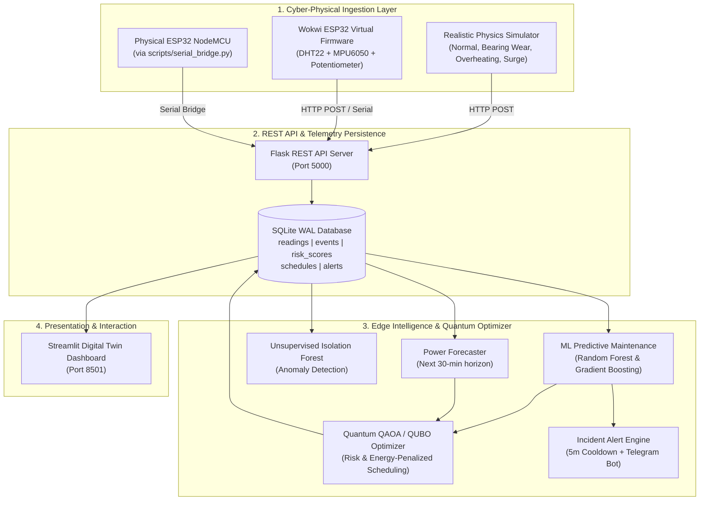

# 🏭 Quantum Digital Twin for Smart Factories

[](https://www.python.org/)
[](https://opensource.org/licenses/MIT)

An end-to-end cyber-physical **Digital Twin** integrating real-time IoT sensor ingestion, predictive maintenance machine learning, unsupervised anomaly detection, and **Quantum Approximate Optimization Algorithm (QAOA)** workload scheduling.

---

## 🏛️ System Architecture



---

## 🌟 Core Features & Phases

1. **🔬 Real Industrial Dataset Validation (UCI AI4I 2020):**
   - Validated on 10,000 real milling machine telemetry records with ~3.4% failure imbalance.
   - Evaluates Logistic Regression, Random Forest, and Gradient Boosting with 5-Fold Stratified Cross-Validation.
   - Preserves high Recall (>81%) and ROC-AUC (>0.97).
2. **🔌 ESP32 Firmware & Wokwi Simulation:**
   - Production Arduino/C++ firmware in `firmware/esp32_wokwi/sketch.ino`.
   - Wiring schematic for DHT22 (temperature), MPU6050 (vibration), and potentiometer (current/power).
   - USB Serial Bridge (`scripts/serial_bridge.py`) supporting live hardware or `--mock` stream.
3. **🌪️ Advanced Multi-Scenario Simulator:**
   - Realistic failure scenarios: `normal`, `bearing_wear`, `overheating`, `power_surge`, and `mixed`.
   - Sensor noise, random dropouts, sensor drift, outlier spikes, and autonomous machine repair cycles.
4. **⚛️ Continuous ML-to-Quantum Autonomous Pipeline:**
   - Runs in the background every 5 seconds.
   - Evaluates risk deltas; triggers QAOA QUBO job reallocation automatically when machine risk shifts.
   - Inserts proactive machine maintenance slots when degradation is detected.
5. **🧪 Interactive What-If Simulation Panel:**
   - Slider overrides for machine risks and forced offline maintenance toggles.
   - In-memory QUBO optimization showing immediate job relocation diffs without altering the live database.
6. **📊 Empirical QAOA vs Classical Benchmark:**
   - Compares Brute Force, Greedy Heuristics, and QAOA across problem sizes (6 to 12 qubits).
   - Evaluates runtime scaling, feasibility rates, and optimality gaps.
7. **🚨 Incident Alerting & Energy Forecasting:**
   - 5-minute cooldown alerts logged to database and optional Telegram bot dispatch.
   - Autoregressive energy forecaster predicting future 30-minute power draw.

---

## ⚖️ Data Honesty Statement

> [!IMPORTANT]
> - **Quantum Computing:** The QAOA scheduler uses Qiskit and currently executes on a classical statevector simulator (or exact classical solver fallback). No real quantum processing unit (QPU) hardware is claimed.
> - **Industrial Data:** Real machine metrics presented in the "Model Validation" tab derive from the genuine **UCI AI4I 2020 Predictive Maintenance Dataset**. Synthetic models are explicitly labeled as **SYNTHETIC / SIMULATED**.
> - **IoT Telemetry:** Simulated telemetry from `simulator.py` and Wokwi virtual firmware is labeled as `simulator` or `esp32-sim`. Only data routed via `scripts/serial_bridge.py` from a physical board is tagged as `esp32-real`.

---

## 🚀 Quick Start Guide

### 1. Prerequisites & Virtual Environment
```bash
git clone https://github.com/example/quantum-digital-twin.git
cd "Project Code"
python -m venv venv
# Windows:
.\venv\Scripts\activate
# Linux/macOS:
source venv/bin/activate

pip install -r requirements.txt
pip install -r requirements-quantum.txt
```

### 2. Launch Complete System (One Command)
Starts the Flask REST API, realistic simulator, ML-to-quantum background pipeline, and Streamlit dashboard:
```bash
python scripts/run_all.py
```
Open **[http://localhost:8501](http://localhost:8501)** to access the Digital Twin Dashboard.

---

## 🛠️ Individual Module Commands

| Task | Command |
|---|---|
| **Run Acceptance Test Suite** | `python scripts/test_pipeline.py` |
| **Run Pytest Unit Tests** | `pytest tests/ -v` |
| **Download UCI Real Dataset** | `python ml/real_data/download_dataset.py` |
| **Train Real Industrial Models** | `python ml/real_data/train_real.py` |
| **Compare Synthetic vs Real** | `python ml/compare_models.py` |
| **Run QAOA Scaling Benchmark** | `python quantum/benchmark.py --quick` |
| **Start Mock Serial Bridge** | `python scripts/serial_bridge.py --mock` |
| **Start Physical USB Serial Bridge** | `python scripts/serial_bridge.py --port COM3 --baud 115200` |
| **Create Demo Backup Snapshot** | `python scripts/make_demo_snapshot.py` |

---

## 🔌 Next Steps with Real Hardware

To deploy on physical machinery:
1. Open `firmware/esp32_wokwi/sketch.ino` in Arduino IDE or PlatformIO.
2. Connect an ESP32 board, DHT22 to GPIO 15, and MPU6050 to GPIO 21/22.
3. Flash the sketch to your board.
4. Connect via USB and run:
   ```bash
   python scripts/serial_bridge.py --port <YOUR_PORT> --baud 115200
   ```
5. Real telemetry is instantly tagged as `esp32-real` and processed by the ML-Quantum loop.

---

## 📄 License
This project is open-source under the MIT License.
